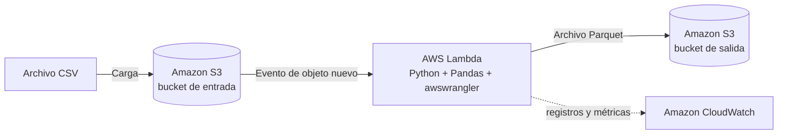

# Pipeline financiero serverless en AWS

Pipeline de datos dirigido por eventos que procesa archivos CSV de transacciones financieras almacenados en Amazon S3. Una función AWS Lambda limpia los registros y genera un archivo Apache Parquet en un bucket de destino, listo para su análisis.

## Arquitectura



### Flujo de procesamiento

1. Se carga un archivo `.csv` en el bucket de entrada.
2. Una notificación de S3 activa la función Lambda.
3. La función lee el archivo, elimina filas vacías y transacciones duplicadas, e intenta normalizar las fechas y los montos.
4. El resultado se escribe en el bucket de salida con extensión `.parquet`.
5. Los registros de ejecución quedan disponibles en CloudWatch.

## Tecnologías

| Servicio o herramienta | Uso |
| --- | --- |
| Amazon S3 | Almacenamiento de archivos de entrada y salida |
| AWS Lambda | Ejecución del procesamiento bajo demanda |
| Python, Pandas y AWS SDK for Pandas (`awswrangler`) | Lectura, limpieza y escritura de datos |
| Apache Parquet | Formato columnar para el resultado |
| Amazon CloudWatch | Registros y métricas de ejecución |

## Estructura del proyecto

```text
.
├── img/                 # Capturas de la implementación en AWS
├── sample_data/
│   └── datos_sucios.csv # Datos de ejemplo con errores y duplicados
├── src/
│   └── lambda_function.py
└── README.md
```

## Reglas de limpieza

La transformación implementada en [`src/lambda_function.py`](src/lambda_function.py):

- Descarta filas completamente vacías.
- Elimina duplicados por `id_transaccion`, conservando la primera aparición.
- Convierte `fecha` a formato `AAAA-MM-DD`; los valores que no se puedan interpretar se convierten en nulos.
- Convierte `monto` a valor numérico; los valores inválidos se convierten en nulos.
- Mantiene las demás columnas del archivo de entrada.

El archivo de ejemplo [`sample_data/datos_sucios.csv`](sample_data/datos_sucios.csv) incluye un duplicado, formatos de fecha distintos, un monto inválido y una fila vacía.

## Despliegue en AWS

Esta versión se configuró desde la consola de AWS. Para reproducirla:

1. Crea dos buckets S3: uno para archivos crudos y otro para resultados procesados. En la configuración actual, el bucket de destino está definido en el código como `finanzas-reportes-limpios-cristian-097`; actualiza `bucket_destino` en `src/lambda_function.py` si usarás otro.
2. Crea una función Lambda con el runtime de Python compatible con la capa de AWS SDK for Pandas que vayas a utilizar. Configura la capa que proporciona `awswrangler` y sus dependencias.
3. Publica el contenido de `src/lambda_function.py` como `lambda_function.py` en el paquete de la función y configura el handler `lambda_function.lambda_handler`.
4. Asigna a la función un rol de ejecución con permisos para leer objetos del bucket de entrada, escribir en el bucket de salida y publicar registros en CloudWatch. No incluyas credenciales de AWS en el código.
5. Configura una notificación de eventos `ObjectCreated` en el bucket de entrada, con el sufijo `.csv`, para invocar la función Lambda.
6. Sube `sample_data/datos_sucios.csv` al bucket de entrada y confirma que se genera `datos_sucios.parquet` en el bucket de salida.

> **Importante:** configura el disparador únicamente en el bucket de entrada. Si el bucket de salida también activa la función, los archivos generados podrían volver a disparar el proceso.

## Evidencias

Las siguientes capturas muestran la carga del CSV, la configuración de Lambda, el resultado Parquet y los registros de CloudWatch. Se ocultaron el correo, el ID de cuenta y el ARN de la función antes de publicar las imágenes.

| Carga del archivo de entrada | Resultado en S3 |
| --- | --- |
|  |  |

| Configuración de Lambda | Ejecución en CloudWatch |
| --- | --- |
|  |  |

En la ejecución capturada, Lambda registró una duración de **915,46 ms** y utilizó **512 MB** de memoria. El tiempo real puede variar según el tamaño del archivo, la inicialización de la función y la configuración de AWS.

## Consideraciones

- La función espera que el CSV incluya las columnas `id_transaccion`, `fecha` y `monto`.
- Los errores en la lectura o escritura se registran y se vuelven a lanzar para que la invocación se reporte como fallida.
- El nombre del bucket de salida está definido directamente en el código; cámbialo antes de desplegar en otro entorno.
- Antes de publicar, revisa que el repositorio no contenga credenciales, archivos `.env` ni datos personales.
